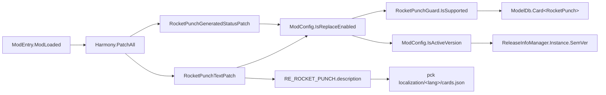

# 001 总体设计

- 版本：1.1.0
- 更新时间：2026-11-19 00:24
- 适用游戏：0.111.1、0.113.1
- 需求与验收：`1.PRD/001-项目初期需求.md`
- 对外规范：`6.SPEC/001-总体规范.md`
- 决策理由：`4.ADR/001-火箭飞拳回调.md`、`4.ADR/002-ModelDb访问时机修复.md`、`4.ADR/004-兼容基线锁定0.111.1与0.113.1.md`

## 1. 上下文与范围

mod 在游戏启动时安装 Harmony 补丁，接管 `RocketPunch.AfterCardGeneratedForCombat` 与 `CardModel.Description` getter。效果与文本只在 0.110 及以上生效；0.107–0.109 保持原版。

范围外：卡牌本体数据、卡图、存档结构、联机协议、其他卡牌。对应 `1.PRD/001-项目初期需求.md` 的非目标。

## 2. 架构总览



## 3. 组件分解

| 组件 | 源码符号 | 负责 | 不负责 |
|---|---|---|---|
| 入口 | `ModEntry.ModLoaded()` | 创建 Harmony 实例、`PatchAll`、捕获异常并记录 | 不读 `ModelDb`、不读 `LocManager`、不做版本判断 |
| 总开关 | `ModConfig.IsReplaceEnabled`、`IsActiveVersion()` | 组合卡牌守卫与版本门；缓存版本结论 | 不安装补丁、不读写本地化 |
| 卡牌守卫 | `RocketPunchGuard.IsSupported()` | 运行时检查 `ModelDb.Card<RocketPunch>()`；成功缓存，失败告警一次并放行 | 不判断版本、不修改费用 |
| 效果补丁 | `RocketPunchGeneratedStatusPatch.Prefix` | 三重守卫后 `EnergyCost.SetUntilPlayed(0)`，全路径短路 | 不处理文本、不处理其他卡牌 |
| 文本补丁 | `RocketPunchDescriptionPatch.Postfix` | 对 `RocketPunch` 且语言受支持时切换到 `RE_ROCKET_PUNCH.description` | 不写入官方键、不判断版本以外的条件 |
| 本地化资源 | `RevertRocketPunch/localization/<lang>/cards.json` | 16 语言描述文本 | 不包含卡名、卡图或其他键 |
| 清单 | `RevertRocketPunch.json` | mod ID、版本、加载门槛、产物声明 | 不描述补丁逻辑 |
| 构建 | `build.ps1`、`8.TEST/CI-CD/verify-version.ps1` | 版本门禁、dotnet 构建、Godot 导入与 export-pack、安装 | 不修改源码、不生成文案 |
| 测试探针 | `8.TEST/1.1/RocketPunchProbe/` | 仅在测试环境安装 `NGame.IsReleaseGame` 后门与 `rpprobe` 命令 | 不进入发布包、不修改产品源码 |

## 4. 依赖与分层

允许方向：

```text
ModEntry → 补丁类 → ModConfig → RocketPunchGuard
文本补丁 → LocManager（运行时）
测试探针 → 游戏程序集（仅测试目录）
```

禁止方向：

| 禁止项 | 静态检查 |
|---|---|
| `ModEntry` 在 `ModLoaded` 访问 `ModelDb` 或 `LocManager` | `grep -n "ModelDb\\|LocManager" 9.SRC/RevertRocketPunch/ModEntry.cs` 无匹配 |
| 补丁类互相引用 | `grep -n "RocketPunchGeneratedStatusPatch\\|RocketPunchDescriptionPatch" 9.SRC/RevertRocketPunch/Patches/*.cs` 只允许自身声明 |
| 产品源码引用 `8.TEST` | `grep -rn "8.TEST\\|RocketPunchProbe" 9.SRC/RevertRocketPunch` 无匹配 |
| 引用 0.113.1 独有 API | 用 0.111.1 的 `sts2.dll` 编译，必须 0 错误 |

## 5. 数据设计

| 数据 | 位置 | 语义 |
|---|---|---|
| `_versionOk` | `ModConfig` | `bool?`；`null` 表示未取得确定版本，下次重试；取值后固化 |
| `_modelOk` | `RocketPunchGuard` | `bool?`；成功为 `true`；失败保持 `null`，下次重试 |
| `_warned` | `RocketPunchGuard` | 保证失败告警只记一次 |
| `RE_ROCKET_PUNCH.description` | pck 内 16 个 `cards.json` | 卡面描述模板，数字由 `DynamicVars` 渲染 |
| `version` | `RevertRocketPunch.json` | 发布版本，必须与 `CHANGELOG.md`、`7.ChangeLog` 一致 |

本地化键与语言集合由 `6.SPEC/001-总体规范.md` 的 SP-004、SP-005 规定。

## 6. 内部接口

| 符号 | 签名 | 说明 |
|---|---|---|
| `ModEntry.ModLoaded` | `static void ModLoaded()` | `[ModInitializer("ModLoaded")]` 入口 |
| `ModConfig.IsReplaceEnabled` | `static bool` | 每次补丁触发时求值 |
| `ModConfig.IsActiveVersion` | `static bool` | 懒求值 + 缓存 |
| `RocketPunchGuard.IsSupported` | `static bool` | 懒求值 + 缓存 |
| `RocketPunchGeneratedStatusPatch.Prefix` | `(RocketPunch, CardModel, Player?, ref Task) → bool` | `false` 表示跳过原实现 |
| `RocketPunchDescriptionPatch.Postfix` | `(CardModel, ref LocString) → void` | 替换返回的本地化键 |

## 7. 关键流程

### 7.1 生成状态牌

1. 游戏调用 `Hook.AfterCardGeneratedForCombat`。
2. Harmony 进入 `RocketPunchGeneratedStatusPatch.Prefix`。
3. `ModConfig.IsReplaceEnabled` 依次检查卡牌守卫与版本门。
4. 不通过：返回 `true`，原版实现执行（0.110+ 为 `AddUntilPlayed(-1)`）。
5. 通过且三重守卫命中：`SetUntilPlayed(0)`，写 `Task.CompletedTask`，返回 `false`。
6. 通过但守卫未命中：写 `Task.CompletedTask`，返回 `false`，等价于 107 的提前返回。

### 7.2 卡面描述

1. 游戏读取 `CardModel.Description`。
2. `RocketPunchDescriptionPatch.Postfix` 检查实例类型、总开关、语言白名单。
3. 通过：返回 `new LocString("cards", "RE_ROCKET_PUNCH.description")`。
4. 不通过：保留原 `LocString`。

## 8. 状态与生命周期

- `ModLoaded` 发生在 `ExecuteVeryEarly`。补丁在此安装，不做任何依赖 `ModelDb` 的检查（ADR-002）。
- `ModConfig._versionOk` 与 `RocketPunchGuard._modelOk` 在首次补丁触发时求值。首次触发通常发生在对局或图鉴，此时 `ModelDb` 已初始化。
- Harmony 实例保存在 `_harmony` 静态字段，进程生命周期内不卸载。
- 版本号与卡牌检查结论在进程内缓存，不跨启动持久化。

## 9. 算法与规则

- 三重守卫与 v0.107.1 原版一致：生成者、牌主、牌类型。
- 费用修改使用绝对修饰符，目标为 0，过期条件为 `WhenPlayed`。
- 版本门：`Major == 0 && Minor >= 110`。
- 语言白名单：`deu/eng/esp/fra/ind/ita/jpn/kor/pol/ptb/rus/spa/tha/tur/zhs/zht`。
- `ara` 不切键，使用官方文本。

规则的可判定表述见 `6.SPEC/001-总体规范.md` 的 SP-001 至 SP-006、SP-011。

## 10. 失败与降级

| 场景 | 行为 | 对应条款 |
|---|---|---|
| `PatchAll` 失败 | 捕获并 `Log.Error`；补丁未安装；游戏按原版运行 | SP-009 |
| `ModelDb` 未就绪或卡牌检查失败 | 告警一次，放行且不缓存，下次重试 | SP-010 |
| `SemVer` 读不到 | 告警，暂按生效处理，下次重试 | SP-009 |
| 语言不在白名单 | 不切键，保留官方文本 | SP-006 |
| 本地化键缺失 | 受支持语言必须由发布检查保证；缺键时 `LocString` 读取会抛异常，构建门禁需拦截 | SP-005 |
| 版本低于 0.110 | 补丁路径全部放行原版 | SP-008 |

## 11. 资源与构建视图

- 运行时资源：`RevertRocketPunch.pck` 内含 `mod_image.png` 与 16 个 `cards.json`；`export_presets.cfg` 显式列出。
- 编译引用：本机 `data_sts2_windows_x86_64/sts2.dll` 与 `0Harmony.dll`，`Private=false`。
- 发布构建：`build.ps1 -Sts2DataDir <0.111.1 引用目录>`，先跑版本门禁，再 `dotnet build`、Godot 导入、`--export-pack`，最后复制到 `mods/RevertRocketPunch/`。
- 测试构建：`8.TEST/1.1/RocketPunchProbe` 单独引用 `sts2.dll`、`0Harmony.dll`、`GodotSharp.dll`，输出到 `mods/RocketPunchProbe/`，测试后移除。

## 12. 需求追溯

| 需求 | 条款 | 源码/资源 | 验证 |
|---|---|---|---|
| RQ-001 | SP-001、SP-002 | `RocketPunchGeneratedStatusPatch.cs` | 0.113.1 场景探针 |
| RQ-002 | SP-003、SP-004、SP-005 | `RocketPunchTextPatch.cs`、`localization/` | 探针读取键与文本 |
| RQ-003 | SP-007、SP-008、SP-009、SP-010 | `ModConfig.cs`、`RocketPunchGuard.cs` | 代码审阅、日志 |
| RQ-004 | SP-011、SP-012 | `RevertRocketPunch.csproj`、`build.ps1` | 双程序集编译、0.113.1 运行 |
| RQ-005 | SP-013 | 全部源码 | 源码审阅 |
| RQ-006 | SP-004、SP-005 | `localization/ind/cards.json` | 文件检查 |
| RQ-007 | SP-016、SP-017 | `verify-version.ps1`、`build.ps1` | 门禁运行 |
| RQ-009 | SP-014 | `RevertRocketPunch.csproj`、manifest | 清单与引用检查 |

## 13. 偏差与限制

- `RocketPunchGuard` 在卡牌检查失败时选择「放行 + 告警」而不是「禁用补丁」。原因是 `PatchAll` 已在 `ModLoaded` 安装，且失败可能只是 `ModelDb` 未就绪；禁用会误伤正常对局。此偏差以 SP-010 为准。
- 0.111.1 的实机运行验证尚未完成；当前结论来自 0.111.1 编译兼容与 0.113.1 运行验证。
- `ara` 的文本正确性依赖 0.113.1 官方本地化；游戏更新后需复核。
- 无头探针不验证视觉排版、动画、音效与多人联机。

## 14. 变更记录

| 时间 | 变更 |
|---|---|
| 2026-11-19 00:24 | 迁移到 `5.SDD`；按新 SDD 规则重写；补双版本兼容、组件边界、需求追溯与偏差 |
